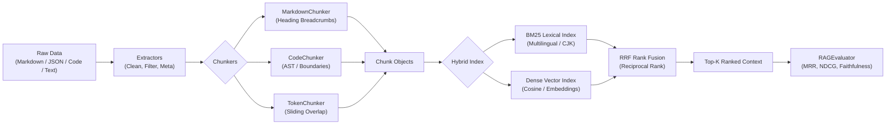

<div align="center">

# ⚡ RAGForge

**A lightweight, blazingly fast, and modular Python toolkit for RAG data pipelines, semantic chunking, hybrid search, and LLM evaluation.**

[](https://github.com/Frank-zhu2000/ragforge/actions)
[](https://github.com/Frank-zhu2000/ragforge/actions)
[](https://pypi.org/project/ragforge/)
[](https://opensource.org/licenses/MIT)
[](https://github.com/psf/black)
[](CONTRIBUTING.md)

[English](README.md) | [中文说明](#-中文文档说明)

</div>

---

## 🌟 Why RAGForge?

Building reliable Retrieval-Augmented Generation (RAG) pipelines often requires juggling bloated frameworks with dozens of heavy dependencies, slow startup times, and opaque abstractions.

**RAGForge** is built from the ground up to be:
- 🪶 **Zero-Bloat Core**: Runs entirely on the Python Standard Library with zero required external dependencies.
- 🧩 **Semantic & Hierarchical Chunking**: Context-aware chunking for Markdown (preserving heading breadcrumbs), Code (functions/classes), and natural language paragraphs.
- ⚡ **True Hybrid Search**: Combines Okapi BM25 sparse lexical search with dense vector similarity via **Reciprocal Rank Fusion (RRF)**.
- 📊 **Built-in RAG Evaluation**: Compute Hit Rate, MRR, Precision@K, Recall@K, NDCG, Context Relevance, and Faithfulness out of the box.
- 🛠️ **Developer-First CLI**: Instant file inspection, chunking preview, and retrieval debugging directly from your terminal.

---

## 🏗️ Architecture



---

## 🚀 Quick Start (in 60 Seconds)

### Installation

```bash
# Clone and install locally
git clone https://github.com/Frank-zhu2000/ragforge.git
cd ragforge
pip install .
```

### 1. Hierarchical Markdown Chunking

Unlike naive character chunkers that sever text blindly, `MarkdownChunker` preserves heading breadcrumbs in chunk metadata:

```python
from ragforge import MarkdownChunker, MarkdownExtractor

text = """
# Storage Architecture
Overview of our persistent layer.

## Relational Databases
We utilize PostgreSQL for transactional ACID consistency.

## In-Memory Cache
Redis powers distributed locks and high-throughput session caching.
"""

# Extract clean document and metadata
doc = MarkdownExtractor().extract_from_string(text)

# Chunk with heading hierarchy tracking
chunker = MarkdownChunker(max_chunk_size=200)
chunks = chunker.chunk_document(doc)

for c in chunks:
    print("Breadcrumb:", c.metadata.get("breadcrumbs"))
    print("Content:", c.text)
    print("---")
```

### 2. Hybrid Search (BM25 + Dense Vectors + RRF)

```python
from ragforge import Chunk, HybridIndex

# Index your documents
corpus = [
    "PostgreSQL handles relational data and transactional queries.",
    "Redis is an in-memory key-value store for caching and pub/sub.",
    "BM25 and vector embeddings combine into hybrid search for RAG.",
]
chunks = [Chunk(chunk_id=f"c_{i}", text=t) for i, t in enumerate(corpus)]

# Initialize hybrid index
index = HybridIndex(vector_dim=64, rrf_k=60)
index.add_chunks(chunks)

# Query using Reciprocal Rank Fusion (RRF)
results = index.search("hybrid search with BM25", top_k=2, method="rrf")

for r in results:
    print(f"Rank #{r.rank} (Score: {r.score:.5f}): {r.chunk.text}")
```

### 3. RAG Pipeline Evaluation

```python
from ragforge.eval import EvaluationSample, RAGEvaluator

samples = [
    EvaluationSample(
        query="What is Redis used for?",
        retrieved_chunk_ids=["chunk_redis", "chunk_mongo"],
        ground_truth_chunk_ids={"chunk_redis"},
        context_text="Redis is an in-memory data structure store used for caching.",
        generated_answer="Redis is primarily used for fast caching.",
    )
]

evaluator = RAGEvaluator(k=2)
report = evaluator.evaluate(samples)

# Print standardized GitHub markdown benchmark report
print(report.to_markdown_table())
```

Output:
```text
| Metric | Value (@k=2) | Description |
| :--- | :---: | :--- |
| **Hit Rate** | `100.00%` | Proportion of queries where relevant chunk was found |
| **MRR** | `1.0000` | Mean Reciprocal Rank of first relevant document |
| **Precision@k** | `50.00%` | Ratio of retrieved chunks that are relevant |
| **Recall@k** | `100.00%` | Ratio of ground truth chunks successfully retrieved |
| **NDCG@k** | `1.0000` | Normalized Discounted Cumulative Gain ranking quality |
| **Context Relevance** | `66.67%` | Question-to-context semantic overlap score |
| **Faithfulness** | `100.00%` | Hallucination avoidance / context grounding score |
```

---

## 💻 CLI Usage

RAGForge includes a colorful, intuitive CLI:

```bash
# Preview semantic chunking on any file
ragforge chunk README.md --strategy markdown --size 300

# Perform hybrid search right from your terminal
ragforge search "BM25 hybrid search" --file README.md --mode hybrid --top-k 3
```

---

## 📊 Feature Comparison Matrix

| Feature | RAGForge | LangChain TextSplitters | LlamaIndex NodeParsers | Unstructured |
| :--- | :---: | :---: | :---: | :---: |
| **Core Dependencies** | **0 (Stdlib)** | 15+ heavy packages | 20+ packages | Heavy OS binary deps |
| **Hierarchical Breadcrumbs** | ✅ Built-in | ⚠️ Partial | ⚠️ Complex setup | ❌ |
| **Code Function Boundary** | ✅ Built-in | ⚠️ Language dependent | ⚠️ Language dependent | ❌ |
| **Multilingual BM25 + CJK** | ✅ Built-in | ❌ External dependency | ❌ External dependency | ❌ |
| **Built-in RRF Rank Fusion** | ✅ Built-in | ⚠️ Requires EnsembleRetriever | ⚠️ Requires QueryEngine | ❌ |
| **Built-in RAG Metrics (MRR/NDCG)**| ✅ Built-in | ❌ Requires Ragas | ❌ Requires Ragas | ❌ |
| **Lightweight CLI** | ✅ Built-in | ❌ | ❌ | ⚠️ Heavy |

---

## 🇨🇳 中文文档说明

### 项目亮点
1. **轻量与零强制依赖**：完全基于 Python 标准库构建，开箱即用，告别庞大冗余的依赖环境冲突。
2. **结构感知切分（Chunking）**：
   - `MarkdownChunker`：自动解析 Markdown 各级标题并注入面包屑元数据（如 `["架构", "存储引擎"]`），为 LLM 检索提供不可或缺的层级上下文。
   - `CodeChunker`：函数与类级别语义切分，防止代码语句被机械腰斩。
   - `TokenChunker`：中英文标点自适应滑动窗口切分。
3. **稀疏 + 稠密混合检索（Hybrid Search）**：
   - 原生支持 Okapi BM25（含中英文 N-Gram 分词）与余弦向量检索。
   - 内置 **RRF（互惠排名融合算法）** 与 Alpha 线性动态加权融合。
4. **全方位 RAG 评测矩阵**：
   - 一键评测 Hit Rate、MRR、NDCG、Precision@K、Recall@K、上下文相关度及幻觉真实性（Faithfulness），可直接输出精美 Markdown 报告。

---

## 🛠️ Testing & CI/CD

All tests can be executed locally without installing external packages:

```bash
python -m unittest discover -s tests -v
```

---

## 📄 License

This project is licensed under the [MIT License](LICENSE) - see the [LICENSE](LICENSE) file for details.

---

<div align="center">
  <b>Crafted with ❤️ by <a href="https://github.com/Frank-zhu2000">Frank Zhu (Frank-zhu2000)</a></b>
</div>
